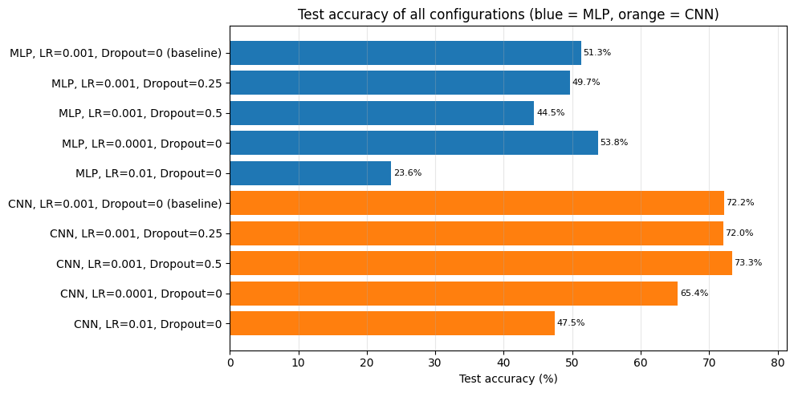
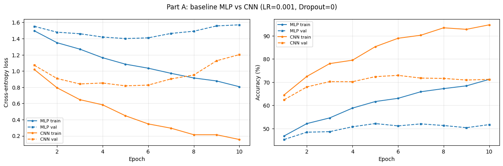
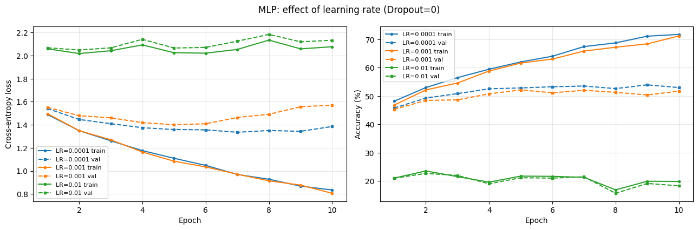
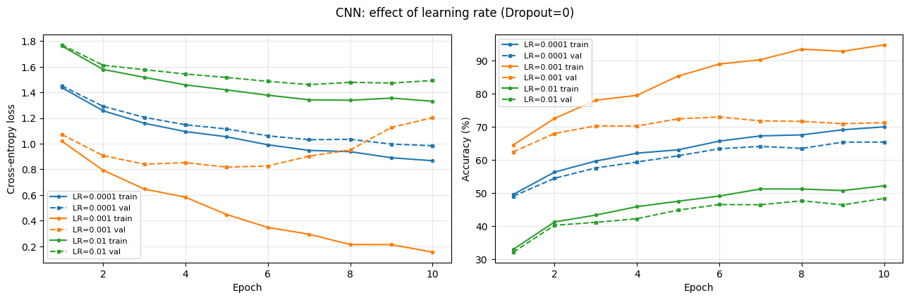
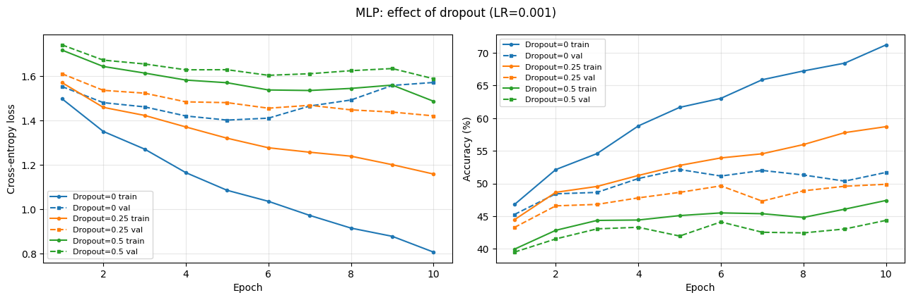
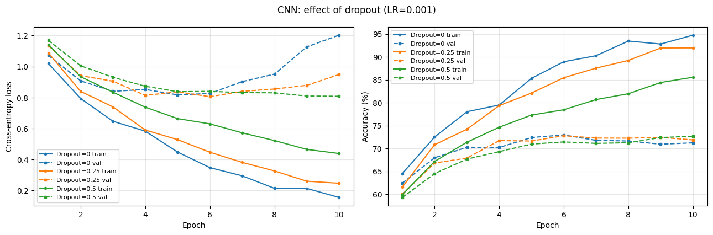

# MLP vs CNN on CIFAR-10

A comparison of a Multi-Layer Perceptron and a small Convolutional Neural Network on CIFAR-10, with controlled experiments on learning rate and dropout. This is my work for **Activity 1** of **CSE 848: Generative AI & Applications**.

**Author:** Malik Saif Ullah

[](https://colab.research.google.com/github/YOUR_GITHUB_USERNAME/cifar10-mlp-vs-cnn/blob/main/notebooks/MLP_vs_CNN_for_CIFAR10.ipynb)

## What this project does

The goal of the activity is to see how architecture and training choices affect image classification. The notebook:

1. Trains a baseline **MLP** and a baseline **CNN** on CIFAR-10 (32 x 32 RGB images, 10 classes).
2. Changes **one parameter at a time**, keeping everything else fixed, for two chosen parameters: **learning rate** (0.01, 0.001, 0.0001) and **dropout** (0, 0.25, 0.5). Both sweeps are run on both models, which gives 10 configurations in total.
3. Records training loss and accuracy, validation accuracy, test accuracy, trainable parameter count, and training curves for every configuration.
4. Summarises everything in a results table with an observation per run, followed by a short discussion.

## Run it in Google Colab

1. Open the notebook with the **Open In Colab** badge above. Alternatively, go to [colab.research.google.com](https://colab.research.google.com), choose `File > Upload notebook`, and upload `notebooks/MLP_vs_CNN_for_CIFAR10.ipynb`.
2. Switch to a GPU: `Runtime > Change runtime type > T4 GPU`. The notebook also runs on CPU, but it is much slower.
3. Run everything with `Runtime > Run all`.

CIFAR-10 (about 170 MB) is downloaded automatically by `torchvision` the first time the data cell runs. The download speed depends on the dataset host and can vary a lot, so the first run may spend most of its time there. In the saved run, each training run took roughly 12 seconds for the MLP and 21 to 23 seconds for the CNN.

All tables, plots, per-run observations and the final discussion are generated by the notebook from the runs, so after **Run all** they always match the numbers on screen.

### Running locally instead

```bash
git clone https://github.com/YOUR_GITHUB_USERNAME/cifar10-mlp-vs-cnn.git
cd cifar10-mlp-vs-cnn
pip install -r requirements.txt
jupyter notebook notebooks/MLP_vs_CNN_for_CIFAR10.ipynb
```

## Experimental setup

| Item | Choice |
|---|---|
| Data split | 45,000 train / 5,000 validation (random split of the official training set) / 10,000 test (official test set) |
| Preprocessing | Per channel normalisation, no data augmentation |
| MLP | Flatten, Linear 3072 to 512, ReLU, Linear 512 to 256, ReLU, Linear 256 to 10 |
| CNN | Conv 3 to 32, ReLU, MaxPool, Conv 32 to 64, ReLU, MaxPool, Linear 4096 to 128, ReLU, Linear 128 to 10 |
| Fixed in every run | Adam optimiser, batch size 64, 10 epochs, seed 42, same data split |
| Baseline values | Learning rate 0.001, dropout 0 |
| Parameters varied | Learning rate (0.01, 0.001, 0.0001) and dropout (0, 0.25, 0.5), one at a time |

Dropout is applied after each hidden layer in the MLP and after the hidden fully connected layer in the CNN.

## Results

These numbers come from the executed notebook in this repository. Train and validation accuracy are from the last epoch. Test accuracy is taken at the epoch with the best validation accuracy.

| Model / Configuration | Test accuracy (%) | Trainable parameters | Train acc (%) | Val acc (%) |
|---|---:|---:|---:|---:|
| MLP, LR=0.001, Dropout=0 (baseline) | 51.29 | 1,707,274 | 71.2 | 51.7 |
| MLP, LR=0.001, Dropout=0.25 | 49.71 | 1,707,274 | 58.7 | 49.9 |
| MLP, LR=0.001, Dropout=0.5 | 44.45 | 1,707,274 | 47.4 | 44.4 |
| MLP, LR=0.0001, Dropout=0 | 53.75 | 1,707,274 | 71.8 | 53.0 |
| MLP, LR=0.01, Dropout=0 | 23.58 | 1,707,274 | 19.8 | 18.3 |
| CNN, LR=0.001, Dropout=0 (baseline) | 72.17 | 545,098 | 94.7 | 71.2 |
| CNN, LR=0.001, Dropout=0.25 | 72.02 | 545,098 | 92.0 | 71.9 |
| CNN, LR=0.001, Dropout=0.5 | 73.34 | 545,098 | 85.5 | 72.7 |
| CNN, LR=0.0001, Dropout=0 | 65.44 | 545,098 | 69.9 | 65.3 |
| CNN, LR=0.01, Dropout=0 | 47.48 | 545,098 | 52.1 | 48.3 |



### Training curves

Solid lines are training, dashed lines are validation.

**Baselines**



**Learning rate sweeps**




**Dropout sweeps**




### Summary of findings

* **Better model:** the CNN. Baseline test accuracy was 72.17% for the CNN against 51.29% for the MLP, and the CNN does this with about 3.1 times fewer trainable parameters (545,098 vs 1,707,274).
* **Largest effect:** learning rate. On the MLP it moved test accuracy by 30.2 points between the best (0.0001) and worst (0.01) setting. Averaged over both models, learning rate changed accuracy by 27.4 points and dropout by 4.1 points.
* **Complexity:** more parameters did not mean better accuracy. The larger MLP is well behind the smaller CNN.
* **Over and underfitting:** both baselines overfit clearly (train minus validation gap of 19.5 points for the MLP and 23.5 for the CNN). Dropout 0.5 narrowed the gap for both, but on the MLP it went too far and the model underfit (47.4% train accuracy, 44.45% test). A learning rate of 0.01 left the MLP badly underfit (23.58% test).
* **Recommended configuration:** the CNN baseline (LR 0.001, dropout 0) was selected by validation accuracy and reaches 72.17% test accuracy.

The full per-run observations and the final discussion are in the notebook, sections 6 and 7.

## Notes and limitations

* **Single seed.** Each configuration was run once with seed 42 for a fixed 10 epochs. A 10,000 image test set carries roughly 0.5 points of sampling noise, so differences below about 1 point should be read as suggestive. GPU kernels can also introduce small run to run differences, so a re-run may not reproduce every digit.
* **The CNN recommendation is close.** The CNN with dropout 0.5 reached a similar validation accuracy (72.7% at the end), a higher test accuracy (73.34%), and was still improving at epoch 10. The notebook picks the baseline because it has the best validation accuracy, but the margin is small, and a longer run would be needed to separate the two.
* **Diagnosis labels are rule based.** The notebook labels a run as underfitting when training accuracy is below 50%, and otherwise by the train to validation gap. The CNN at learning rate 0.01 is therefore labelled "good fit" because its gap is small, even though its accuracy is low (52.1% train, 47.48% test). It is better read as poorly optimised.
* **One factor at a time** cannot reveal interactions, for example whether stronger dropout pays off with a longer training budget.

## Repository structure

```
cifar10-mlp-vs-cnn/
├── notebooks/
│   └── MLP_vs_CNN_for_CIFAR10.ipynb   # all code, results, plots, observations and discussion
├── assets/                            # figures used in this README (exported from the notebook)
├── requirements.txt
├── .gitignore
└── README.md
```

## Assignment requirements covered

The activity asks for one notebook that contains all the work. In this repository the notebook includes:

| Requirement | Where in the notebook |
|---|---|
| Student name and registration number at the top | Header cell |
| Complete MLP and CNN code with training and evaluation | Sections 2 and 3 |
| Baseline results (loss, accuracy, test accuracy, parameters, curves) | Section 4 |
| At least three experimental configurations using two parameters | Section 5 (learning rate and dropout, 8 experiments plus 2 baselines) |
| Test accuracy and trainable parameters for each configuration | Section 6 table |
| Training loss and accuracy curves | Sections 4 and 5 |
| Results table with an observation per experiment | Section 6 |
| Final discussion | Section 7 |
